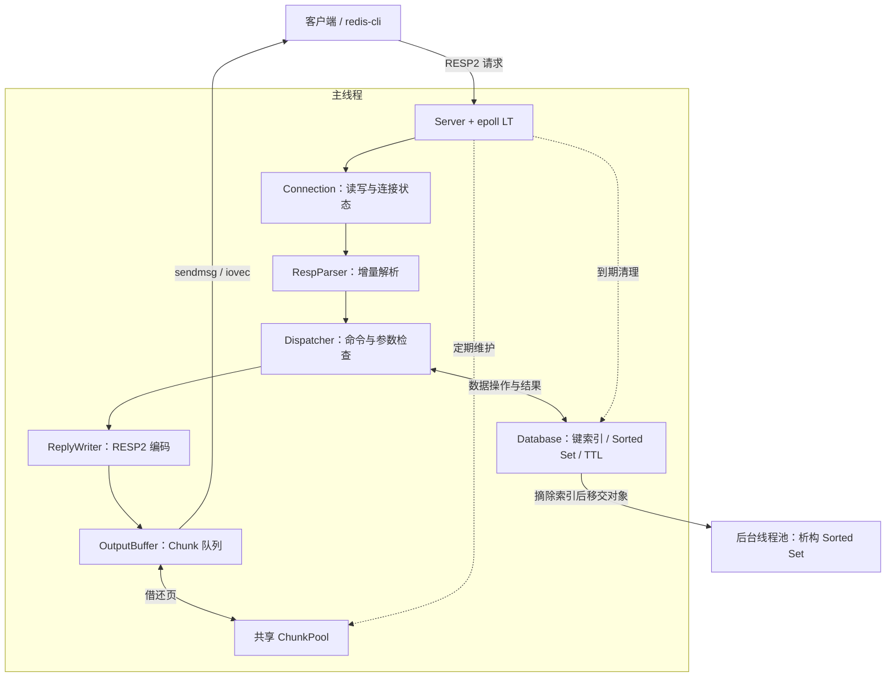
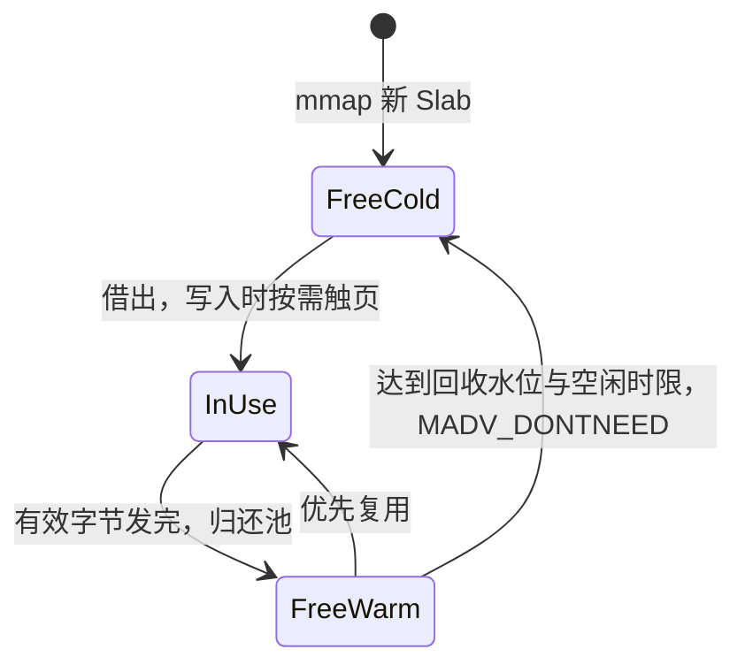

# Redlet

Redlet 是我用 C++17 实现的小型内存键值数据库，运行在 Linux 上，支持字符串、有序集合和键过期，通过 RESP2 协议与 `redis-cli` 交互。

项目从 [Build Your Own Redis](https://build-your-own.org/redis/) 起步，逐步加入了渐进式 rehash、基于 AVL 树的 Sorted Set、后台析构，以及借鉴 vLLM 分块管理思路的输出内存池。实现之外，我也在追踪一些具体问题：扩容为什么会卡住其他请求，大对象交给后台销毁后为什么仍有延迟毛刺，大回复发完后内存为什么没有降下来。对应的对照实验和排查记录都放在仓库里。

[快速运行](#快速运行) · [实现与取舍](#实现与取舍) · [性能实验](#性能实验) · [测试](#测试) · [源码导览](#源码导览)

## 实现概览

| 部分 | 当前实现 |
| --- | --- |
| 网络 | 非阻塞 TCP Socket、单线程 Reactor、epoll LT；按待发数据动态关注 `EPOLLOUT`，支持部分读写、`EAGAIN` 和连接半关闭 |
| 协议 | 增量 RESP2 解析、二进制安全参数、Pipeline；解析器保存偏移量，命令执行时借用输入字节 |
| 键索引 | 自实现侵入式哈希表，双表渐进扩缩容，同时限制节点迁移量和桶扫描量 |
| 有序集合 | 侵入式 Hash / AVL 双索引，共享成员数据；AVL 节点维护子树大小，支持排名和按排名范围查询 |
| 过期与超时 | 索引最小堆管理 TTL，访问时惰性删除，每轮限额主动清理；双向链表维护连接空闲顺序 |
| 后台任务 | 用标准库线程、互斥锁和条件变量实现线程池，负责已脱离数据库的 Sorted Set 析构 |
| 输出内存 | 页大小 Chunk、跨连接共享池、`sendmsg` 聚集发送；以 `madvise` 回收空闲页，以 `munmap` 释放空闲 Slab |

普通命令和活跃数据都由事件循环线程处理。后台线程只接收待销毁对象，输出内存池的借还与维护也留在主线程。



## 快速运行

服务端使用 C++17 标准库和 Linux 系统接口，无第三方运行库依赖。仓库提供 [Ubuntu 24.04 开发容器](.devcontainer/Dockerfile)，包含 GCC、GDB 和 `redis-tools`。使用 VS Code 的 Dev Containers 打开仓库，选择 **Reopen in Container**，然后在容器内的 `/workspace` 执行：

```bash
bash build.sh
./redlet
```

默认监听 `127.0.0.1:6379`。在同一容器中新开一个终端：

```bash
redis-cli PING
# PONG

redis-cli SET greeting 'hello, Redlet'
redis-cli GET greeting
# "hello, Redlet"

redis-cli ZADD leaderboard 100 alice 80 bob 120 carol
redis-cli ZRANGE leaderboard 0 -1 WITHSCORES
redis-cli ZRANK leaderboard alice
# (integer) 1

redis-cli SET session:42 active PX 60000
redis-cli PTTL session:42
redis-cli PERSIST session:42
```

客户端也在容器内运行，因为服务端只绑定回环地址。原生 Linux 可以直接使用同样的构建命令；macOS 和 Windows 通过开发容器运行。

支持的命令范围：

| 类型 | 命令 |
| --- | --- |
| 连通性 | `PING [message]` |
| 字符串与删除 | `GET key`、`SET key value [PX milliseconds]`、`DEL key [key ...]` |
| 有序集合 | `ZADD key score member [score member ...]`、`ZREM key member [member ...]`、`ZSCORE key member`、`ZRANK key member`、`ZRANGE key start stop [WITHSCORES]` |
| 过期时间 | `PEXPIRE key milliseconds`、`PTTL key`、`PERSIST key` |

命令名不区分大小写，`ZRANGE` 支持负下标。这里实现的是 Redis 命令子集，未列出的选项和命令不支持。

## 实现与取舍

### 用 Chunk 管理回复的生命周期

原来的输出缓冲是连接私有的 `std::string`。部分发送后删除前缀，需要搬移剩余字节；一次大回复还可能让连接长期保留很大的容量。大量长连接轮流读取大 value 时，这两项成本会累积。

我借鉴了 [vLLM PagedAttention 的分块管理思路](https://vllm-project.github.io/2023/06/20/vllm.html)：把按需增长的数据拆成固定大小的块，用共享池复用空闲块。在 Redlet 中，这个思路用于 CPU 上的网络输出缓冲，块大小取系统基础页大小，不涉及 KV Cache 或注意力计算。

每个连接按需借用 Chunk，追加回复只写队尾，发送成功后推进 `sent` 游标。一个块里的有效字节全部发送后就归还，即使这个块没有写满。`sendmsg` 通过 `iovec` 一次提交多个块，不需要先把它们拼成连续字符串。



每个 Slab 包含 256 个 Chunk。控制块与数据页分开存放，因此一个 Slab 仍有活页时，也能回收其中其他空闲页；整个 Slab 空闲足够久后再 `munmap`。维护过程限制每轮系统调用次数，并设置软时间预算，避免集中回收占住事件循环。

这套实现消除了输出前缀搬移，回复编码和普通 Socket 发送仍有数据复制。小回复也要借一页，块管理有额外开销；回收后的再次写入可能产生缺页。这些代价在实验里都有记录。

源码：[OutputBuffer](src/buffer/output_buffer.hpp)、[ChunkPool](src/buffer/chunk_pool.hpp)、[PageSlab](src/buffer/page_slab.hpp)；[设计记录](benchmarks/3-chunk-pool/plan.md)与[对照实验](benchmarks/3-chunk-pool/note.md)。

### Sorted Set 采用 AVL 树

有序集合使用哈希表和 AVL 树两套索引。同一个成员节点同时嵌入 `HashHook` 和 `AVLHook`，成员名和分数只保存一份。哈希表按成员名定位节点，AVL 按 `(score, member)` 排序；同分成员按成员名字典序排列。

AVL 节点除高度外还维护子树大小：`ZRANK` 沿父链累计排名，`ZRANGE` 先按排名定位起点，再沿后继遍历。树上的排名与定位为 `O(log N)`，返回 M 个成员的范围查询为 `O(log N + M)`。

这里选择 AVL 而非 Skip List，获得了严格平衡的树高，并通过子树计数支持排名。代价是插入、删除和旋转时，需要同时维护父子指针、高度与计数。项目尚未做 AVL 与 Skip List 的性能对照。

源码：[SortedSet](src/storage/sorted_set.hpp)、[AVLTree](src/storage/avl_tree.hpp)、[双索引节点](src/storage/node.hpp)。

### 把 rehash 的迁移工作分摊到多次操作

键空间增长时，一次集中 rehash 会让单线程服务暂停处理其他请求。`ProgressiveRehashMap` 在迁移期间保留新旧两张表，查找检查两张表，后续插入进入目标表，正常操作同时推进迁移。

每次迁移最多处理 128 个节点、扫描 256 个桶。两种预算分别限制长冲突链和稀疏桶扫描带来的工作量。这会暂时多占一份桶数组，查询也可能访问两张表；新桶数组的分配仍然同步执行，所以迁移预算不代表严格的单请求耗时上限。

这套哈希表同时用于数据库键索引和 Sorted Set 成员索引。源码：[ProgressiveRehashMap](src/storage/progressive_rehash_map.hpp)、[HashTable](src/storage/hash_table.hpp)；[百万键写入实验](benchmarks/1-progressive-rehash/note.md)。

### 析构移到后台后，仍然出现过秒级毛刺

删除 Sorted Set 时，主线程先把它从键索引和过期索引中摘除，再把对象交给线程池析构。这样，遍历并释放大量成员的工作可以离开事件循环。当前默认 16 个 worker，尚未按集合大小区分同步与异步销毁，也没有任务队列上限。

这部分实现曾出现一个容易误判的问题：`DEL` 已经很快返回，但约 900 ms 后，PING 和普通 GET/SET 又一起卡住。线程栈和反汇编显示，worker 在队列锁内执行 `std::deque` 出队，释放存储块时进入了 glibc `malloc_consolidate` 的慢路径。与此同时，普通字符串 SET 误把 `nullptr` 包装成销毁任务提交，主线程因此等待同一把锁。

修复是在统一回收入口过滤空指针，让普通 SET 不再接触这条任务队列。队列内的分配与释放成本仍然存在，后台 worker 也仍会与主线程争用 CPU；后续实验专门记录了主线程的调度等待。

源码：[Database](src/storage/database.hpp)、[ThreadPool](src/concurrency/thread_pool.hpp)；[毛刺排查记录](benchmarks/2-async-destroy/small-issue.md)与[削峰及调度代价实验](benchmarks/2-async-destroy/notes.md)。

## 性能实验

以下是仓库中已记录的阶段性对照结果，比较对象均为 Redlet 自身的历史版本。实验运行在 Ubuntu 24.04 / Linux ARM64 容器中，服务端和发压端绑定不同 CPU，每项取五轮结果的中位数。完整环境、版本和测量口径见各实验记录。

| 改动与场景 | 指标 | 优化前 | 优化后 | 变化 |
| --- | --- | ---: | ---: | --- |
| 渐进式 rehash；100 万次随机键 SET，单连接、无 Pipeline、64 B value | 各轮最大延迟的中位数 | 64.479 ms | 6.255 ms | 下降 90.30% |
| 异步析构；一次删除 64 个集合、每集合 10 万成员，同时持续 PING 和 GET/SET | 删除后 5 秒内的 PING 最大 RTT，中位数 | 1152.422 ms | 4.351 ms | 下降 99.62% |
| ChunkPool；1 MiB GET，单连接、无 Pipeline | 完成请求数 / 秒 | 2,980 | 7,476 | 提高 150.9% |
| 同上 | 完整回复 p99 | 0.3586 ms | 0.1472 ms | 下降 58.95% |
| ChunkPool；256 条长连接，每组 16 条轮流读取 1 MiB | 进程采样峰值 RSS | 262.48 MiB | 20.38 MiB | 下降 92.2% |
| 同上，连接保持存活 | 回复排空 15 秒后的 RSS | 262.48 MiB | 4.80 MiB | 下降 98.2% |

异步析构实验使用 8 个 worker，服务端所有线程共享两核预算；当前代码默认 16 个 worker。ChunkPool 对照双方都使用 64 KiB 发送预算，并开启 `TCP_NODELAY`。提高发送预算和 TCP 开关本身的收益没有计入内存池对照。

实验也留下了几个需要继续关注的结果：

- 64 B 小回复、8 连接、Pipeline 深度 32 时，ChunkPool 版本吞吐下降约 14.7%，批次 p99 从 0.0550 ms 增至 0.1468 ms。
- 未开启 `TCP_NODELAY` 的早期实验中，大回复出现了约 40～47 ms 的 p99。服务端开关和客户端 QUICKACK 对照支持 Nagle、延迟 ACK 与分段发送相互影响的解释，具体报文时序尚未抓包确认。当前服务端已开启 `TCP_NODELAY`。
- 异步回收的 worker 活跃期间，主线程每次调度的平均运行队列等待，中位数从无删除对照的 0.271 μs 增至 115.464 μs。

实验入口：[rehash](benchmarks/1-progressive-rehash/note.md) · [异步析构](benchmarks/2-async-destroy/notes.md) · [输出缓冲池](benchmarks/3-chunk-pool/note.md)。输出缓冲池的[发压、诊断与绘图脚本](benchmarks/3-chunk-pool/scripts/)已提交；生成的 `results/` 目录被 Git 忽略，主要结果保留在实验文档表格中。异步析构的部分实验脚本仍在原实验容器的临时目录，仓库保留了记录和图表。

## 测试

在 Linux 开发容器内运行：

```bash
bash tests/run.sh
SANITIZE=1 bash tests/run.sh
```

测试入口逐个编译并运行 `tests/*_test.cpp`；第二条命令启用 AddressSanitizer 和 UndefinedBehaviorSanitizer。当前有 8 个测试程序，覆盖：

- RESP 请求在不同字节位置切分、二进制参数、Pipeline、非法长度与请求上限。
- 命令与回复编码、TTL 更新和取消、访问时过期判断、主动清理预算，以及过期堆的随机操作对照。
- 短写、`EINTR`、`EAGAIN`、`EPIPE`、慢读与半关闭，检查回复是否完整且有序。
- Chunk 状态转换、输出追加失败回滚、池耗尽、`mmap` / `madvise` / `munmap` 失败，以及无网络事件时的定期维护。

故障路径通过链接器 `--wrap` 注入，测试不依赖实际把系统内存耗尽或偶然发生网络错误。

## 当前范围

Redlet 目前是单机、纯内存服务，进程退出后数据丢失。尚未实现持久化、主从复制、集群、事务、发布订阅和 RESP3，也不支持 Redis 的全部数据类型与命令选项。

单参数上限 1 MiB，单请求上限 2 MiB（含协议开销），最多 1,024 个参数；单连接待发送数据上限 4 MiB，连接空闲超时为 60 秒。输出超限或分配失败会关闭连接，已完成的数据修改不会回滚。当前没有根据输出高低水位暂停、恢复读取的背压机制。

通用参数位于 [config.hpp](src/config.hpp)，池参数位于 [PoolConfig](src/buffer/chunk_pool.hpp)。内存池默认最多映射 256 MiB，这个限制只约束输出池，不是整个进程或数据库的内存上限。

## 源码导览

| 入口 | 内容 |
| --- | --- |
| [src/main.cpp](src/main.cpp)、[src/server.hpp](src/server.hpp) | 启动、事件循环、连接管理与定期维护 |
| [src/net/](src/net/) | epoll 封装、连接读写、空闲连接队列 |
| [src/protocol/](src/protocol/)、[src/command/](src/command/) | RESP2 解析、回复编码与命令分发 |
| [src/storage/](src/storage/) | 数据库、渐进式哈希表、AVL、Sorted Set、过期堆 |
| [src/buffer/](src/buffer/) | 输出队列、Chunk 控制块、Slab 与共享池 |
| [src/concurrency/](src/concurrency/) | 后台销毁线程池 |
| [tests/](tests/)、[benchmarks/](benchmarks/) | 正确性测试、性能实验与问题排查 |
| [docs/](docs/) | 首版设计与早期优化思路，保留当时的方案背景；当前能力以源码和本文为准 |

