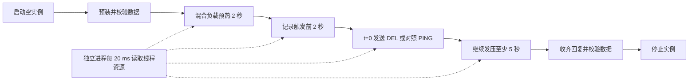
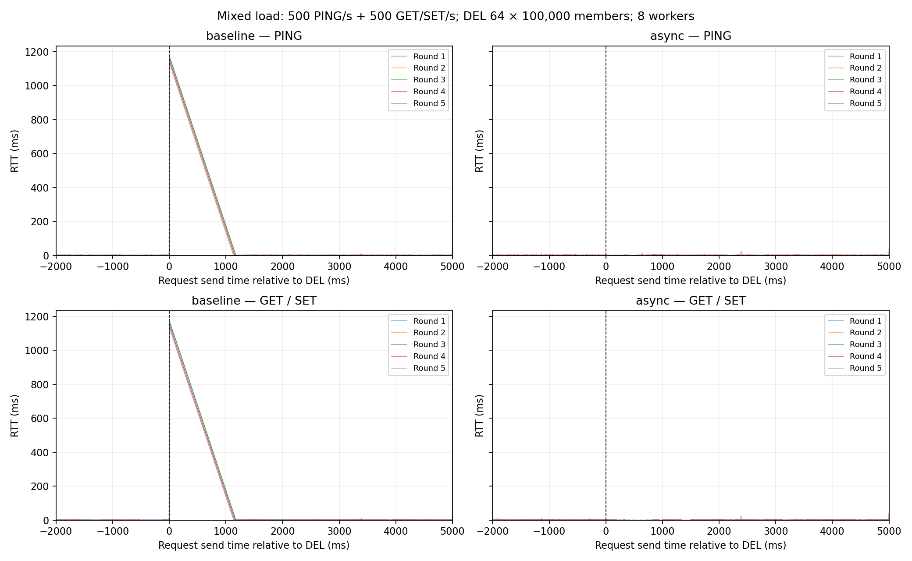
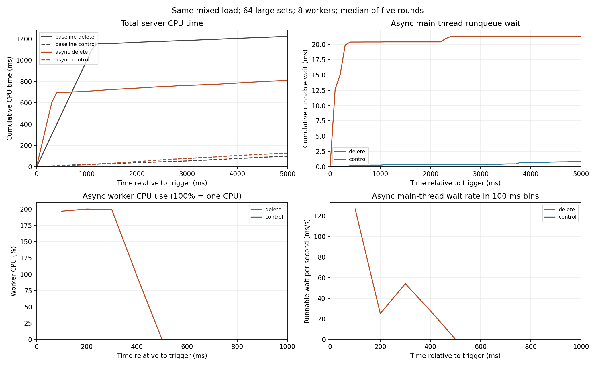

# 异步回收的削峰效果与调度代价

## 目标与结论

对比 `redlet-expire` 和修复空指针任务后的 `redlet-async-destroy-8`，在相同负载下观察两项结果。

1. **异步销毁削峰**。PING 最大 RTT 的五轮中位数从 1152.422 ms 降至 4.351 ms，下降 99.62%。
2. **异步销毁带来调度竞争**。worker 活跃期间，主线程每次调度的平均运行队列等待，五轮中位数从无删除对照的 0.271 μs 升至 115.464 μs，五轮方向一致。

第二项量化了事件循环等待 CPU 的成本。本轮完整业务 RTT 和固定速率下的完成吞吐仍有波动，尚未得到一致退化的结论。

## 实验流程

| 项目 | 设置 |
| --- | --- |
| 环境 | Ubuntu 24.04 Linux 容器，ARM64，glibc 2.39，10 个可用 CPU，约 8 GiB 内存 |
| CPU 分配 | 服务端全部线程共享 CPU 2、3，发压进程固定 CPU 4，新增观测进程固定 CPU 5 |
| 版本 | 同步基线 `redlet-expire`，异步版 `redlet-async-destroy-8` |
| 实际线程数 | 基线 1，异步版 9，其中 8 个 worker，逐轮核验 |
| 大表 | 64 个 SortedSet，每表 100,000 个成员，共 640 万个成员 |
| 成员 | 32 字节补零序号，score 为序号 |
| 短业务数据 | 1,024 个字符串键，每个 value 为 64 字节 |
| client01 | 持续 500 PING/s |
| client02 | 持续 500 GET/SET/s，每 500 条各占一半，随机键和 SET 值 |
| client03 | t=0 发送一条 DEL，删除全部 64 张表 |
| 无删除对照 | 相同预装和负载，client03 在 t=0 发送 PING，保留大表 |
| 重复次数 | 两版本 × 删除/对照 × 五轮，共 20 次独立启动 |

三个客户端使用独立长连接，由同一个 Python selectors 进程发压，总速率为 1,000 请求/s。



- 沿用上一轮的数据、负载、时序、CPU 预算和随机种子，仅增加只读资源观测。
- Python 直接发送 RESP 预装，每条 ZADD 至多 256 个成员，校验添加数和各表最后一个成员的 ZRANK。采样后校验删除结果及全部业务回复。
- 每轮重启实例，按轮次交替版本及删除/对照先后顺序。同轮随机种子为 `20261109 + 轮次`，请求内容预先生成并核对指纹。
- 两条持续连接各每 2 ms 发一次，相位错开 1 ms，发送独立于回复。持续到触发后至少 5 秒，并覆盖触发回复后至少 1 秒，最后收齐回复。
- 集中 DEL 提供明确零点。无 DEL 对照提供相同业务负载下的背景值。固定双核预算使 worker 与事件循环共享计算资源。

## 观察数据与统计口径

### 原有请求指标

逐请求记录计划发送、实际发送、完整回复到达的单调时钟时间。

- RTT 为实际发送到完整回复的耗时，同时保存发送调度延迟和计划到回复的延迟。
- t=0 为 client03 实际发送时刻。按实际发送时刻统计前 2 秒、前 200 ms、后 200 ms、后 5 秒和后 1～5 秒。
- p99/p99.9 使用最近秩法。汇总取五轮同一指标的中位数，另列逐轮峰值。
- 新增按回复到达时刻统计完成请求率，并与 worker 活动对齐。

### 新增资源指标

每 20 ms 读取 `/proc/<pid>/task/<tid>/schedstat` 和线程 `status`。按 TID 将主线程与 8 个 worker 分开统计，使用同一单调时钟对齐请求。

| 数据项 | 用途 |
| --- | --- |
| 主线程、worker 累计 CPU 时间 | 区分业务线程执行和后台销毁的 CPU 使用 |
| 主线程运行队列等待时间 | 观察线程已可运行、等待获得 CPU 的耗时 |
| 调度次数、非自愿切换次数 | 观察调度竞争，计算每次调度的平均等待 |
| worker CPU 随时间变化 | 定位后台 CPU 活跃阶段 |
| 业务 RTT、完成请求率 | 观察同一阶段客户端可见的影响 |
| 进程 RSS | 观察驻留内存变化 |

`schedstat` 的三个计数器分别表示 CPU 执行时间、运行队列等待时间和调度次数。计数器取窗口差值，边界采用线性插值。[Linux 内核文档](https://docs.kernel.org/scheduler/sched-stats.html)

主线程每次调度的平均等待为 `窗口等待时间增量 / 调度次数增量`。一个请求可能涉及多次线程调度，完整 RTT 还包含网络、收包调度和命令执行等耗时。

为避免把回收完成后的时间混入活动阶段，每轮以 t=0～5 秒累计 worker CPU 的 **1%～99%** 定义近似活跃窗口。对照组使用同轮相同的相对时间窗口。窗口由 CPU 计数器确定，精度受 20 ms 采样粒度影响，任务级准确完成时刻仍需单独标记。

进一步计算等待速率 `等待毫秒数 / 窗口秒数`，并用触发前 1 秒做背景校正，即 `(删除组活跃期速率－删除组触发前速率)－(对照组同窗口速率－对照组触发前速率)`。

选择独立只读采样，可以复用已有二进制和完整实验流程。对象级埋点可获得准确析构边界，但需要额外编译产物，本轮采用 CPU 活跃窗口近似。

## 实验结果

2026-11-09 完成 20 次实验，校验通过 **180,028 条持续请求**，包含预热样本。同轮四组随机负载一致，运行前后二进制指纹一致。

### 1. 削峰效果

以下单位为 ms，均取五轮指标中位数，请求指标窗口为 t=0～5 秒。

| 指标 | 同步基线 | 8-worker |
| --- | ---: | ---: |
| DEL 响应 | 484.208 | 3.770 |
| PING p99 | 1103.930 | 3.779 |
| PING p99.9 | 1149.377 | 4.042 |
| PING 最大 RTT | 1152.422 | 4.351 |
| 业务平均 RTT | 135.741 | 1.247 |
| 业务 p99 | 1107.616 | 3.764 |
| 业务 p99.9 | 1152.340 | 4.145 |
| 业务最大 RTT | 1155.358 | 4.209 |

PING 峰值中位数下降 **99.62%**，业务峰值中位数下降 **99.64%**。

| 轮次 | 基线 DEL | 异步 DEL | 基线 PING max | 异步 PING max | 基线业务 max | 异步业务 max |
| --- | ---: | ---: | ---: | ---: | ---: | ---: |
| 1 | 484.208 | 3.778 | 1175.530 | 40.913 | 1175.797 | 3.736 |
| 2 | 469.264 | 3.768 | 1147.349 | 4.073 | 1147.428 | 4.209 |
| 3 | 1170.474 | 3.939 | 1168.620 | 3.858 | 1170.447 | 3.875 |
| 4 | 1155.414 | 0.656 | 1152.422 | 4.351 | 1155.358 | 41.240 |
| 5 | 458.634 | 3.770 | 1133.756 | 25.576 | 1133.981 | 41.849 |

异步第 1 轮 PING、第 4、5 轮业务的约 41 ms 峰值出现在窗口末尾。第 5 轮 PING 的 25.576 ms 峰值在 t≈2.386 秒。全部样本均保留，五轮最差 PING 为 40.913 ms，最差业务为 41.849 ms。



### 2. 主线程调度代价

先看固定 t=0～5 秒窗口，异步版主线程累计运行队列等待如下。

| 轮次 | 执行 DEL / ms | 无 DEL 对照 / ms |
| --- | ---: | ---: |
| 1 | 21.309 | 1.586 |
| 2 | 27.197 | 1.146 |
| 3 | 20.448 | 0.294 |
| 4 | 19.352 | 0.434 |
| 5 | 26.218 | 0.838 |
| 中位数 | **21.309** | **0.838** |

等待主要集中在 worker 活跃阶段。以下比较每轮同一相对时间窗口。

| 轮次 | worker 近似活跃窗口 / ms | 删除组主线程累计等待 / ms | 对照组累计等待 / ms | 删除组平均每次调度等待 / μs | 对照组平均每次调度等待 / μs |
| --- | --- | ---: | ---: | ---: | ---: |
| 1 | 4.7～352.8 | 18.363 | 0.185 | 105.538 | 0.793 |
| 2 | 4.4～349.5 | 23.746 | 0.051 | 138.360 | 0.271 |
| 3 | 4.3～343.8 | 19.262 | 0.000 | 115.464 | 0.000 |
| 4 | 5.3～359.7 | 16.234 | 0.282 | 66.365 | 1.490 |
| 5 | 4.3～402.5 | 23.418 | 0.000 | 115.818 | 0.000 |

五轮均出现等待增加。近似活跃窗口内，主线程平均每次调度等待的中位数从 **0.271 μs 增至 115.464 μs**。

经触发前背景校正，五轮新增等待速率如下，方向仍一致。

| 轮次 | 新增等待速率 / ms/s |
| --- | ---: |
| 1 | 52.020 |
| 2 | 68.546 |
| 3 | 56.514 |
| 4 | 44.336 |
| 5 | 58.637 |

worker 活跃期的 CPU 使用接近两个核，主线程获得 CPU 的等待随之增加，随后趋于平稳。




### 3. CPU、业务延迟与内存

下表为 t=0～5 秒各指标的五轮中位数。

| 指标 | 基线删除 | 基线对照 | 异步删除 | 异步对照 |
| --- | ---: | ---: | ---: | ---: |
| 服务端总 CPU 时间 / ms | 1222.409 | 96.926 | 810.110 | 126.602 |
| 其中 worker CPU 时间 / ms | 0 | 0 | 691.308 | 0 |
| 业务平均 RTT / ms | 135.741 | 1.457 | 1.247 | 1.714 |
| t=5 秒 RSS / MiB | 979.926 | 1044.168 | 980.090 | 1044.305 |

- 本轮异步删除的总 CPU 时间低于同步删除。已量化的代价体现为主线程调度等待增加。
- worker 活跃窗口内，两条持续连接各自的完成速率仍约为 500 请求/s。本轮使用固定请求速率，饱和吞吐容量尚未测量。
- 业务平均 RTT 的变化方向受背景波动影响，调度等待的增量尚未表现为稳定的完整请求 RTT 增量。
- RSS 统计整个进程的驻留页，包含分配器保留的内存。对象的准确析构完成时间和待回收内存量需要对象级观测。

## 采样影响与适用范围

- 观测进程固定在 CPU 5。其 CPU 占用中位数约为基线采样 2.37%、异步采样 7.02%，以一个核为 100%。每组均开启采样。
- 计划采样间隔 20 ms，实测最大相邻间隔 34.56 ms，单次读取最长 17.99 ms。资源窗口边界采用近似值。
- 删除组客户端发送调度最大延迟为基线 9.632 ms、异步 24.480 ms，毫秒级 RTT 包含客户端调度影响。
- 结论适用于当前双核服务端预算、8 个 worker 和单次集中删除。持续删除下的任务积压、内存峰值和饱和吞吐仍需另外测量。

## 上一轮无资源采样的复测

同样采用 64 张大表和 8 个 worker，共 20 次实验、180,027 条请求。除最差轮次外，下表均取五轮指标中位数，单位为 ms。

| 指标 | 同步基线 | 8-worker |
| --- | ---: | ---: |
| DEL 响应 | 507.336 | 3.870 |
| PING 最大 RTT | 1200.533 | 4.386 |
| 业务平均 RTT | 146.353 | 1.050 |
| 业务 p99 | 1150.823 | 2.829 |
| 业务最大 RTT | 1200.646 | 5.330 |
| 五轮最差业务 RTT | 1219.510 | 40.712 |

上一轮图表保存在 `results/mixed-load-64-8-fixed/`。

## 产物与复现

关键统计集中在本文 Markdown 表格中，图表保留 PNG 和 PDF 两种格式。

| 实验 | 延迟曲线 | 业务对照 | 资源代价 |
| --- | --- | --- | --- |
| 本轮资源观测 | [延迟图](results/mixed-load-64-8-observed/latency.png) | [业务图](results/mixed-load-64-8-observed/business-cost.png) | [资源图](results/mixed-load-64-8-observed/resource-cost.png) |
| 上一轮无资源采样 | [延迟图](results/mixed-load-64-8-fixed/latency.png) | [业务图](results/mixed-load-64-8-fixed/business-cost.png) | — |

使用用户提供的二进制，具体编译命令未核验。运行前后 SHA-256 一致。

| 产物 | SHA-256 |
| --- | --- |
| `redlet-expire` | `636bbaa448949de0d1d6273712778fc2451d92eff985313526b8ab790539f1a8` |
| `redlet-async-destroy-8` | `ee3fb56300c1822f573a20659cccb68664816567c56d3757b3bb97f93e423c39` |

脚本位于容器 `/tmp/redlet-8worker/`，逐请求与逐次资源采样位于 `/tmp/redlet-8worker-observed/results/`。容器临时文件会随重建丢失。

在容器 `/workspace` 下执行，输出目录需尚不存在。

```sh
python3 /tmp/redlet-8worker/run_observed.py \
  --keys 64 --members 100000 --rounds 5 \
  --async-binary redlet-async-destroy-8 --expected-workers 8 \
  --server-cpus 2,3 --client-cpu 4 \
  --output /tmp/redlet-8worker-observed/results
python3 /tmp/redlet-8worker/plot.py /tmp/redlet-8worker-observed/results
python3 /tmp/redlet-8worker/analyze_resources.py /tmp/redlet-8worker-observed/results
```
