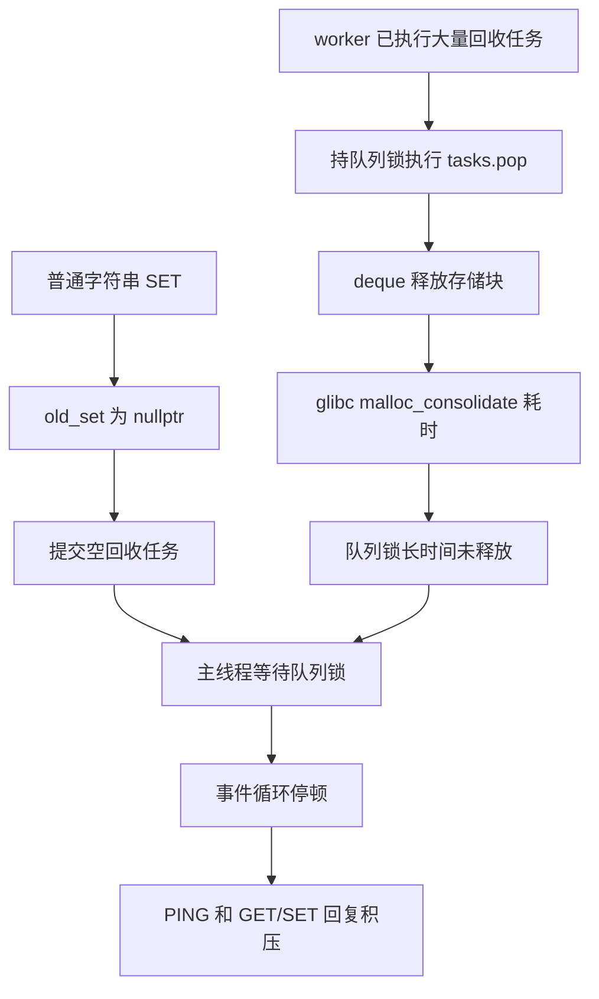

# 空任务把事件循环拖进了锁竞争

## 现象

64 张大 SortedSet 交给 8 个 worker 回收后，DEL 很快返回，但约 900 ms 后 PING 和短业务请求一起出现长停顿。修复前五轮业务最大 RTT 为 1.316～1.456 秒。

## 阻塞链

普通字符串 SET 更新已有键时，`old_set` 为 `nullptr`，仍调用了 `destroy_sorted_set(old_set)`。提交空任务需要获取线程池队列锁。

与此同时，一个 worker 在持锁执行 `tasks.pop()`。`std::queue` 默认使用 `std::deque`，本次出队释放了一个 512 字节的存储块，进入 glibc 的 `malloc_consolidate`，整理此前大量释放积累的空闲块，延长了持锁时间。



## 定位依据

- 在 DEL 后约 1.05 秒和 1.40 秒抓取线程栈，主线程均停在 `destroy_sorted_set → pthread_mutex_lock → futex_wait`。
- 一个 worker 均停在 `worker_loop → free → malloc_consolidate`，其余七个 worker 等待条件变量。
- 结合锁地址和反汇编，确认慢释放来自锁内的 deque 存储块回收。任务函数本身已在解锁后执行。
- 临时版本仅增加空指针判断，三轮业务最大 RTT 降到 15.917、14.027、18.791 ms。正式重新编译版本的对照结果见 [notes.md](notes.md)。
- 正式新版五轮复测，PING 峰值中位数从同步基线的 1200.533 ms 降至 4.386 ms，业务峰值中位数降至 5.330 ms，五轮最差业务峰值为 40.712 ms。

约 900 ms 的触发位置与回收进度、队列存储块边界和堆状态有关。GDB 抓栈会短暂停进程，延迟数值采用独立的无调试器实验。

## 修复与体会

在统一回收入口过滤空指针，让普通字符串 SET 直接返回。

```cpp
void destroy_sorted_set(SortedSet* sorted_set) {
    if (sorted_set == nullptr) return;
    // 提交实际需要执行的回收任务。
}
```

`delete nullptr` 本身合法，但把它包装成异步任务会引入加锁、排队和唤醒开销。此次修复切断了普通 SET 对回收队列的无效依赖。队列的入队和出队仍可能调用分配器，临界区耗时需要覆盖这些隐含操作。

## 面试表述

> 我把大 SortedSet 的析构移到线程池后，用 PING 和随机 GET/SET 混合压测，发现 DEL 很快返回，但稍后仍有秒级停顿。抓线程栈并结合反汇编，定位到 worker 在队列锁内释放 deque 存储块，触发了分配器的慢路径。普通 SET 又误提交了空指针回收任务，导致事件循环等待同一把锁。我在回收入口过滤空指针，再用相同负载验证。这个问题让我认识到，异步化需要检查主线程仍然依赖哪些锁，以及容器操作隐藏的分配和释放成本。
