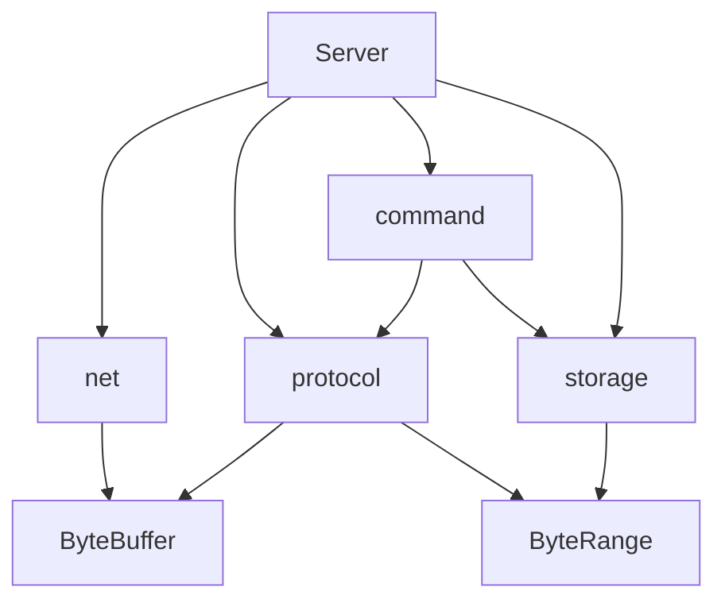

# Redlet 建议目录结构

日期：2026 年 11 月 3 日。

本方案用于 Redlet 首版代码组织。用户已确认两项原则：按职责分目录，首版不要求每个模块分别构建成独立库；同一模块的头文件与源文件放在一起。下文的目录名、文件名与函数拆分是落实这些原则的建议，可在实现时局部调整。

技术选型以[首版设计基准](redlet-v1-design-baseline.md)为准，后续实验以[后续优化参考表](redlet-optimization-reference.md)为参考。当前组织目标是让网络、协议、命令和存储各自保持清楚的职责，并把后续修改集中到相关模块。

## 首版目录与文件

下表路径均相对于项目根目录。`xxx.hpp/.cpp` 表示对应的头文件和实现文件；简单类型可以只放在头文件中，不需要为每个声明配一个实现文件。

| 位置 | 建议文件 | 职责 |
| --- | --- | --- |
| `src/` | `main.cpp` | 程序入口，读取启动配置，创建并运行服务器 |
| `src/` | `server.hpp/.cpp` | 装配模块，管理连接，串联事件处理与请求处理流程 |
| `src/` | `config.hpp` | 集中声明监听地址、端口、请求限制和输出硬上限等配置 |
| `src/net/` | `event_loop.hpp/.cpp` | 封装 epoll 注册、修改、删除和等待，提供就绪事件 |
| `src/net/` | `connection.hpp/.cpp` | 管理 fd、连接状态、输入输出缓冲及非阻塞读写 |
| `src/buffer/` | `byte_buffer.hpp/.cpp`、`byte_range.hpp` | 连续缓冲、游标、整理扩容，以及只读逻辑字节范围 |
| `src/protocol/` | `resp_parser.hpp/.cpp`、`reply_writer.hpp/.cpp` | 识别完整请求并生成参数范围；把回复编码到输出缓冲 |
| `src/command/` | `dispatcher.hpp/.cpp` | 命令识别、参数检查、数据库调用与回复生成 |
| `src/storage/` | `database.hpp/.cpp` | 字符串读写、删除、键索引及数据所有权 |
| `tests/unit/` | 按被测模块组织测试 | 验证缓冲、解析、编码与数据库的局部行为 |
| `tests/integration/` | 服务器与客户端交互测试 | 验证半包、pipeline、部分写入、连接关闭和限额行为 |
| `bench/` | 场景脚本、配置、实验说明 | 复现特定负载，记录基线及优化前后的表现 |
| `docs/` | 设计基准、优化参考、实验记录 | 保存设计约定、实验方法与结论 |

四个基础命令先放在一个 `dispatcher.cpp`，分别用处理函数组织即可。解析结果与请求描述可先放在 `resp_parser.hpp`，等内容或复用需求增长后，再拆出独立头文件。暂不需要命令类层次、处理器工厂，也不预建空的 `timer/`、`thread_pool/`、`zset/` 目录。

## Server 与 Connection 的边界

### Connection 管理网络状态

`Connection` 持有一条连接的 fd、状态、incoming、outgoing 及游标，负责实际的非阻塞读取和发送。它报告实际读取或发送的数量、暂时不可读写、对端关闭及错误等结果。

连接层不解释 RESP 字段，不识别 GET 或 SET，也不直接访问 `Database`。输出硬上限等连接资源约束可以保存在连接状态或配置中，但命令语义不应因此进入网络层。

### Server 串联请求处理

`Server` 维护服务器级对象及连接管理，将就绪事件交给对应连接，再安排解析、命令执行、回复编码和后续发送。连接关闭时，由这一层与网络层协调事件注销、fd 关闭及对象释放。

首版可以由 `Server` 直接承担这段串联逻辑，保留清楚的内部函数边界。以后加入命令预算、高低水位或继续执行队列时，再按实际复杂度拆分调度对象。无需在尚未出现这些状态前增加一套调度框架。

`EventLoop` 先负责 epoll 封装和就绪事件提供即可。它可以返回事件，由 `Server` 处理；不需要反向包含 `server.hpp`，也不需要先建立 `IPoller`、多个后端实现和额外的 Reactor 层次。

## 模块依赖

箭头表示允许的代码依赖，不表示运行时的数据流。`ByteBuffer` 与 `ByteRange` 都属于 `buffer/`，其中存储层仅需使用通用的只读字节范围。

依赖边界落实为以下接口规则：

| 边界 | 建议做法 |
| --- | --- |
| EventLoop 与 Server | 事件由下层提供，处理流程由上层组织，避免下层依赖服务器类 |
| ReplyWriter 与 Connection | Writer 接收输出缓冲及追加预算，不接收整个连接，不发送 socket |
| Database 与请求 | 存储操作接收必要的 key/value 范围，不接收完整 RESP 请求或连接对象 |
| Database 与命令处理 | 存储层返回状态和必要数据，由命令层选择回复；不返回预编码的 RESP 字节 |
| Buffer 与上层 | 缓冲和范围实现不认识命令、数据库或 epoll |

`ByteRange` 表达一段借用字节的范围及访问方式，不把上层接口固定为 `std::string_view` 或连续裸指针。首版只需让它适配当前连续缓冲，提供实际需要的读取、比较与复制能力。未来改为分段存储时，再扩充访问实现，无需现在实现庞大的通用迭代器体系。

数据库可以接受这种通用范围，但不应取得 incoming 的消费权，或依赖整个 `ByteBuffer` 的扩容、整理与网络读取行为。

## 一次请求的处理流程

首版普通请求按以下步骤推进：

1. `Server` 取得就绪事件并找到连接，调用连接读取，形成当前有限输入批次。
2. `RESPParser` 查看尚未消费的数据，返回完整请求、需要更多数据或非法输入。
3. 得到完整请求后，`Dispatcher` 识别命令、检查参数，再调用 `Database` 的操作。
4. 命令处理器调用 `ReplyWriter`，同步把状态或数据编码到 outgoing。
5. 本条命令的输入借用结束后，推进输入消费位置，继续处理本批次内的完整请求。
6. 按实现中明确的发送策略推进 outgoing，并更新事件关注；关闭条件交回连接管理路径处理。

“处理一条完整请求”应保留为清楚的内部步骤，方便日后调整每批处理数量。首版仍采用已经确认的策略：处理完当前有限输入批次中的完整请求，再交回事件循环。

### 借用有效期

请求及参数范围借用 incoming。使用这些范围期间，不进行会让其失效的整理、重置或存储迁移。采用偏移量也需要定义坐标与重定位规则，不能自动消除生命周期问题。

SET 持久保存的数据必须由数据库取得所有权。GET 若返回借用数据，须在允许的有效期内完成同步回复编码，不能让网络发送阶段继续引用该数据库对象。

ReplyWriter 成功编码后，outgoing 持有回复字节。后续部分发送只推进发送游标。追加将超过输出硬上限时，Writer 报告失败，由连接管理停止推进并进入关闭路径；已经完成的数据库修改不因此回滚。

以后若暂停处理已有请求，需要明确继续执行机制。完整请求留在 incoming 时，即使 socket 暂时没有新数据，也必须能被再次安排处理。

## 后续功能的落点

| 后续工作 | 主要修改位置 | 应继续保留的边界 |
| --- | --- | --- |
| 自写哈希表及渐进迁移 | `storage/` 内的索引实现与 `Database` | 命令层继续调用存储操作，不依赖桶或迭代器 |
| ZSet | 存储数据结构、类型操作及对应命令处理 | 类型与生命周期规则由存储层管理 |
| TTL | 过期索引、查找删除路径，以及服务器的定时调度 | 删除和对象生命周期保持统一入口 |
| 大对象后台销毁 | 对象脱离索引、所有权交接与后台任务 | 活跃数据库继续由主线程管理，待销毁对象有明确所有者 |
| 分段缓冲或块池 | `buffer/` 与网络 I/O 适配 | 上层使用逻辑范围，继续遵守借用有效期 |
| 公平调度与背压 | `Server` 的请求推进、连接状态及继续执行机制 | 复用单条请求处理步骤，恢复时同时处理已有用户态数据 |

这些是预期的修改集中位置，不承诺所有接口永远不变。新增类型和调度状态可能扩充接口，但不应要求每个上层模块同时了解底层实现。

## 构建与验证

首版产出一个服务程序。为了让测试复用实现代码，可以设置一个内部核心构建目标；这仍符合“各模块不必分别成为独立库”的选择。具体构建工具、C++ 标准、测试框架与编译选项在实现阶段固定并记录。

`tests/` 验证行为正确性，`bench/` 记录特定负载下的表现。协议和存储的局部测试无需启动监听 socket；涉及事件推进、部分读写和连接管理的行为，则通过集成测试验证。

性能实验按场景保存脚本、参数和结果说明，记录基线与优化提交、环境、有效吞吐、延迟、资源占用及错误断连情况。优化时继续运行相关正确性测试，再依据[优化参考表](redlet-optimization-reference.md)中的场景判断收益与代价。
